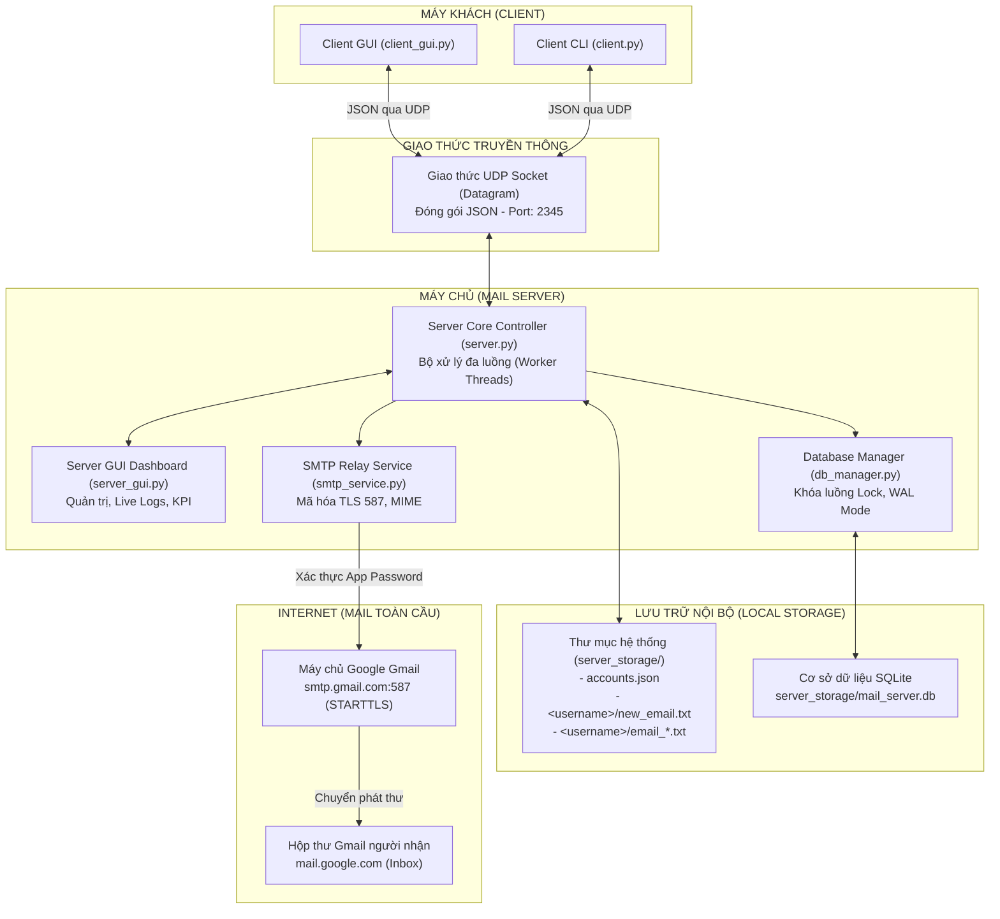
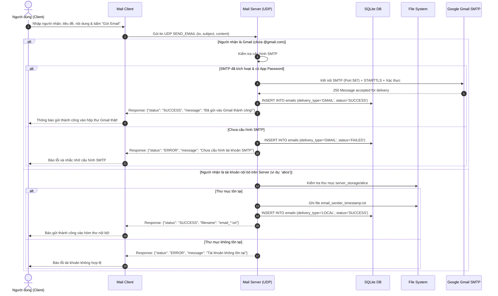

# BÁO CÁO BÀI TẬP LỚN MÔN HỌC: LẬP TRÌNH MẠNG
## ĐỀ TÀI: XÂY DỰNG HỆ THỐNG MAIL SERVER & MAIL CLIENT ĐA GIAO THỨC (UDP SOCKET, CƠ SỞ DỮ LIỆU SQLITE & GMAIL SMTP RELAY)

---

- **Học kỳ:** Kỳ 1 - Năm học 2026 - 2027
- **Học phần:** Lập trình mạng (Network Programming)
- **Nền tảng phát triển:** Python 3, UDP Socket, Tkinter GUI, SQLite3, SMTPLib (STARTTLS)
- **Hệ điều hành thử nghiệm:** Linux (Ubuntu) / Windows

---

## MỤC LỤC
1. [GIỚI THIỆU & MỤC TIÊU ĐỀ TÀI](#1-giới-thiệu--mục-tiêu-đề-tài)
2. [KIẾN TRÚC TỔNG THỂ HỆ THỐNG](#2-kiến-trúc-tổng-thể-hệ-thống)
3. [THIẾT KẾ GIAO THỨC TRUYỀN THÔNG TẦNG ỨNG DỤNG (UDP)](#3-thiết-kế-giao-thức-truyền-thông-tầng-ứng-dụng-udp)
4. [THIẾT KẾ CƠ SỞ DỮ LIỆU & LƯU TRỮ HỆ THỐNG](#4-thiết-kế-cơ-sở-dữ-liệu--lưu-trữ-hệ-thống)
5. [CƠ CHẾ GỬI EMAIL THỰC TẾ RA GMAIL (SMTP RELAY)](#5-cơ-chế-gửi-email-thực-tế-ra-gmail-smtp-relay)
6. [CÁC TÍNH NĂNG NỔI BẬT & CHI TIẾT CÀI ĐẶT](#6-các-tính-năng-nổi-bật--chi-tiết-cài-đặt)
7. [GIAO DIỆN NGƯỜI DÙNG (SERVER GUI & CLIENT GUI)](#7-giao-diện-người-dùng-server-gui--client-gui)
8. [KỊCH BẢN KIỂM THỬ & KẾT QUẢ THỰC NGHIỆM](#8-kịch-bản-kiểm-thử--kết-quả-thực-nghiệm)
9. [HƯỚNG DẪN CÀI ĐẶT & VẬN HÀNH](#9-hướng-dẫn-cài-đặt--vận-hành)
10. [KẾT LUẬN & HƯỚNG PHÁT TRIỂN](#10-kết-luận--hướng-phát-triển)

---

## 1. GIỚI THIỆU & MỤC TIÊU ĐỀ TÀI

### 1.1. Đặt vấn đề
Hệ thống thư điện tử (Email) là một trong những dịch vụ mạng nền tảng của Internet. Việc nghiên cứu, thiết kế và hiện thực hóa một hệ thống Mail Server và Mail Client giúp sinh viên nắm vững nguyên lý hoạt động của socket mạng, xử lý đa luồng (multi-threading), thiết kế giao thức truyền thông tầng ứng dụng, quản lý lưu trữ dữ liệu và tích hợp với các máy chủ thư điện tử tiêu chuẩn quốc tế như Google Gmail.

### 1.2. Mục tiêu đề tài
- **Đáp ứng chuẩn xác 100% yêu cầu đề bài môn Lập trình mạng:**
  1. **Đăng ký tài khoản mới (Register):** Tự động sinh thư mục tài khoản riêng biệt tại máy chủ và khởi tạo file thư chào mừng `new_email.txt` với nội dung yêu cầu.
  2. **Gửi email (Send Email):** Nhận email từ Client qua giao thức UDP Socket, xác định người nhận và tạo file email có định dạng thời gian và nội dung chi tiết.
  3. **Đăng nhập (Login):** Xác thực tài khoản, mở thư mục tài khoản trên Server và gửi danh sách tên file về Client để hiển thị.
  4. **Tự động đăng xuất khi Server dừng (Auto Kickback):** Khi quản trị viên bấm dừng Server, hệ thống phát tín hiệu `SERVER_STOPPED` để toàn bộ Client đang kết nối lập tức văng về màn hình đăng nhập.
  5. **Đọc email (Read Email):** Cho phép Client yêu cầu đọc nội dung bất kỳ file nào trong hộp thư.
- **Mở rộng nâng cao (Điểm sáng của đề tài):**
  - **Tích hợp Cơ sở dữ liệu SQLite (`mail_server.db`):** Lưu trữ toàn bộ thông tin tài khoản và nhật ký email một cách có cấu trúc, hỗ trợ truy vấn, tìm kiếm và phân loại nhanh chóng.
  - **Gửi thư thực tế ra Gmail (Gmail SMTP Relay):** Khi người gửi nhập địa chỉ Gmail thực tế (ví dụ: `user@gmail.com`), Server sẽ đóng vai trò trung chuyển (Relay), kết nối bảo mật STARTTLS tới `smtp.gmail.com:587` để bắn email trực tiếp vào Hộp thư đến (Inbox) thực tế của người nhận.
  - **Giao diện đồ họa Tkinter hiện đại:** Bổ sung Server Dashboard quản trị đầy đủ KPI, Live Logs, quản lý Storage, quản lý Database và cấu hình SMTP cùng Client GUI đa nhiệm.

---

## 2. KIẾN TRÚC TỔNG THỂ HỆ THỐNG

### 2.1. Sơ đồ kiến trúc
Hệ thống hoạt động theo mô hình Client - Server kết hợp cơ chế Relay ra Internet:



### 2.2. Phân tầng công nghệ
1. **Tầng Giao vận (Transport Layer):** UDP (`socket.SOCK_DGRAM`) giúp truyền tải thông điệp nhanh chóng, không tốn tài nguyên thiết lập bắt tay 3 bước của TCP.
2. **Tầng Ứng dụng (Application Layer Protocol):** Giao thức định dạng JSON tự định nghĩa với cơ chế Request-Response phân biệt qua trường `req_id`.
3. **Tầng Xử lý đồng thời (Concurrency Layer):** `threading.Thread` độc lập cho từng gói tin nhận được và hàng đợi an toàn luồng `queue.Queue`.
4. **Tầng Lưu trữ (Persistence Layer):** Kết hợp song song hệ thống file (File System Storage) và Hệ quản trị cơ sở dữ liệu quan hệ nhẹ SQLite3.
5. **Tầng Mạng mở rộng (External Mail Protocol):** Giao thức SMTP chuẩn RFC kết hợp mã hóa bảo mật STARTTLS và chuẩn định dạng MIME (RFC 2045/2047).

---

## 3. THIẾT KẾ GIAO THỨC TRUYỀN THÔNG TẦNG ỨNG DỤNG (UDP)

Hệ thống sử dụng các gói tin datagram mã hóa UTF-8 định dạng JSON. Để giải quyết đặc tính phi kết nối (connectionless) của UDP, mỗi yêu cầu được gắn một `req_id` (UUID v4) duy nhất giúp Client ánh xạ chính xác gói tin phản hồi tương ứng.

### 3.1. Bảng đặc tả các lệnh giao thức

| Lệnh (Action) | Vai trò | Dữ liệu gửi từ Client (Request) | Dữ liệu Server phản hồi (Response) |
| :--- | :--- | :--- | :--- |
| **`CONNECT`** / **`PING`** | Kiểm tra trạng thái máy chủ | `{"action": "CONNECT", "req_id": "..."}` | `{"status": "SUCCESS", "message": "..."}` |
| **`REGISTER`** | Đăng ký tài khoản mới | `{"action": "REGISTER", "username": "...", "password": "...", "req_id": "..."}` | `{"status": "SUCCESS/ERROR", "message": "..."}` |
| **`LOGIN`** | Đăng nhập tài khoản | `{"action": "LOGIN", "username": "...", "password": "...", "req_id": "..."}` | `{"status": "SUCCESS/ERROR", "files": ["f1", ...], "username": "..."}` |
| **`LIST_FILES`** | Tải lại danh sách email | `{"action": "LIST_FILES", "username": "...", "req_id": "..."}` | `{"status": "SUCCESS", "files": ["new_email.txt", ...]}` |
| **`READ_EMAIL`** | Đọc nội dung email cụ thể | `{"action": "READ_EMAIL", "username": "...", "filename": "...", "req_id": "..."}` | `{"status": "SUCCESS", "filename": "...", "content": "..."}` |
| **`SEND_EMAIL`** | Gửi email (Nội bộ hoặc Gmail) | `{"action": "SEND_EMAIL", "from": "...", "to": "...", "subject": "...", "content": "...", "req_id": "..."}` | `{"status": "SUCCESS/ERROR", "message": "...", "delivery_type": "LOCAL/GMAIL", "email_id": 1}` |
| **`LOGOUT`** | Đăng xuất tài khoản | `{"action": "LOGOUT", "username": "...", "req_id": "..."}` | `{"status": "SUCCESS", "message": "..."}` |
| **`SERVER_STOPPED`** | Server thông báo dừng khẩn | *(Máy chủ phát broadcast tới mọi Client đang mở)* | `{"action": "SERVER_STOPPED", "status": "SERVER_STOPPED", "message": "..."}` |
| **`QUIT`** | Client thông báo đóng phiên | `{"action": "QUIT", "req_id": "..."}` | `{"status": "SUCCESS", "message": "Tạm biệt!"}` |

### 3.2. Sơ đồ tuần tự xử lý gửi thư (Sequence Diagram)



---

## 4. THIẾT KẾ CƠ SỞ DỮ LIỆU & LƯU TRỮ HỆ THỐNG

Dự án áp dụng mô hình lưu trữ kép (**Hybrid Storage Architecture**): Vừa lưu file `.txt` phân cấp theo thư mục để tuân thủ tuyệt đối quy định bài tập lớn, vừa lưu trữ vào Cơ sở dữ liệu quan hệ **SQLite** để phục vụ quản lý chuyên nghiệp.

### 4.1. Cấu trúc Cơ sở dữ liệu SQLite (`server_storage/mail_server.db`)

Hệ thống kích hoạt cơ chế `PRAGMA journal_mode=WAL;` (Write-Ahead Logging) kết hợp với `threading.Lock()` nhằm đảm bảo an toàn toàn vẹn dữ liệu khi nhiều client gửi gói tin UDP cùng lúc.

#### Bảng `emails`: Lưu trữ nhật ký và nội dung toàn bộ email
```sql
CREATE TABLE IF NOT EXISTS emails (
    id INTEGER PRIMARY KEY AUTOINCREMENT,
    sender TEXT NOT NULL,
    recipient TEXT NOT NULL,
    subject TEXT,
    content TEXT,
    created_at TEXT NOT NULL,
    delivery_type TEXT NOT NULL,  -- 'LOCAL', 'GMAIL', 'BOTH'
    status TEXT NOT NULL,         -- 'SUCCESS', 'FAILED'
    status_message TEXT DEFAULT '',
    file_path TEXT DEFAULT ''
);

CREATE INDEX IF NOT EXISTS idx_emails_sender ON emails(sender);
CREATE INDEX IF NOT EXISTS idx_emails_recipient ON emails(recipient);
CREATE INDEX IF NOT EXISTS idx_emails_created_at ON emails(created_at);
```

#### Bảng `accounts`: Lưu trữ tài khoản người dùng
```sql
CREATE TABLE IF NOT EXISTS accounts (
    username TEXT PRIMARY KEY,
    password TEXT NOT NULL,
    created_at TEXT NOT NULL
);
```

### 4.2. Cấu trúc thư mục dữ liệu trên máy chủ
```
server_storage/
├── mail_server.db      # Cơ sở dữ liệu SQLite lưu toàn bộ email & tài khoản
├── smtp_config.json    # File JSON cấu hình kết nối Gmail SMTP Relay
├── accounts.json       # Lưu trữ tài khoản dạng JSON (đồng bộ cùng SQLite)
├── alice/              # Thư mục cá nhân của tài khoản 'alice'
│   ├── new_email.txt   # File thư chào mừng tự động sinh khi đăng ký
│   └── email_bob_20261024_204218.txt  # Thư do bob gửi tới
└── bob/
    └── new_email.txt
```

---

## 5. CƠ CHẾ GỬI EMAIL THỰC TẾ RA GMAIL (SMTP RELAY)

### 5.1. Nguyên lý hoạt động
Để gửi email thực tế đến một địa chỉ Gmail bất kỳ (như `tranthang20060903@gmail.com`) mà không bị các bộ lọc thư rác quốc tế chặn:
1. Python Mail Server đóng vai trò là một **MTA trung gian (Mail Relay)**.
2. Server đọc cấu hình tài khoản gửi từ `smtp_config.json`.
3. Sử dụng module chuẩn `smtplib` khởi tạo kết nối TCP tới `smtp.gmail.com` tại cổng bảo mật `587`.
4. Thực hiện lệnh `EHLO` và nâng cấp kênh truyền bảo mật bằng cơ chế **STARTTLS**.
5. Xác thực tài khoản bằng **Google App Password (Mật khẩu ứng dụng 16 ký tự)**.
6. Đóng gói thông điệp theo chuẩn MIME đa năng (`MIMEMultipart`, `MIMEText`) với tiêu đề được mã hóa `UTF-8` bằng `email.header.Header` để đảm bảo tiếng Việt có dấu hiển thị hoàn hảo trên giao diện Gmail Web và ứng dụng Gmail di động.
7. Máy chủ Google tiếp nhận và chuyển tiếp thư ngay lập tức vào **Hộp thư đến (Inbox)** của người nhận.

### 5.2. File cấu hình `server_storage/smtp_config.json`
```json
{
    "enabled": true,
    "smtp_host": "smtp.gmail.com",
    "smtp_port": 587,
    "use_tls": true,
    "sender_email": "tranthang20060903@gmail.com",
    "sender_password": "xxxx xxxx xxxx xxxx",
    "sender_name": "Python Mail Server"
}
```

---

## 6. CÁC TÍNH NĂNG NỔI BẬT & CHI TIẾT CÀI ĐẶT

### 6.1. Xử lý đa luồng (Multi-threading Concurrency)
- **Non-blocking UDP Dispatcher:** Máy chủ UDP không xử lý trực tiếp nội dung gói tin trong vòng lặp lắng nghe chính `recvfrom()`. Thay vào đó, mỗi datagram nhận được sẽ lập tức được bàn giao cho một luồng nền độc lập (`threading.Thread(target=dispatch_client_packet)`). Nhờ đó, việc gửi email qua Gmail SMTP mất 2 - 3 giây xử lý mạng sẽ **không bao giờ làm nghẽn** các client khác đang đăng nhập hoặc đọc thư.

### 6.2. Cơ chế dừng Server an toàn và Auto-Kickback
- Khi Server bấm dừng, hàm `controller.stop()` sẽ duyệt toàn bộ danh sách `active_clients`.
- Phát gói tin `SERVER_STOPPED` lặp lại 3 lần (với độ trễ 15ms) để bù đắp tỉ lệ mất gói tin cố hữu của giao thức UDP.
- Tại Client, luồng nhận ngầm phát hiện mã `SERVER_STOPPED` và kích hoạt hàm `root.after()` đưa Client GUI ngay lập tức trở lại màn hình Đăng nhập kèm hộp thoại cảnh báo.

### 6.3. Tìm kiếm và phân loại dữ liệu trên Database
- Tab Quản trị CSDL hỗ trợ lọc nhanh theo:
  - Hình thức gửi: `TẤT CẢ`, `LOCAL` (nội bộ), `GMAIL` (thực tế).
  - Trạng thái: `TẤT CẢ`, `SUCCESS` (thành công), `FAILED` (thất bại).
  - Ô tìm kiếm linh hoạt: Tìm theo tên người gửi, người nhận, tiêu đề hoặc nội dung thư.

---

## 7. GIAO DIỆN NGƯỜI DÙNG (SERVER GUI & CLIENT GUI)

### 7.1. Giao diện Máy chủ Quản trị (`server_gui.py`)
Giao diện quản trị phong cách Dashboard hiện đại, chia thành 6 Tab chức năng:
1. **Thẻ thống kê nhanh (KPI Dashboard):**
   - Trạng thái Server (ĐANG CHẠY / ĐANG DỪNG).
   - Tổng số tài khoản người dùng (`X Users`).
   - Tổng số email lưu trong Cơ sở dữ liệu (`X DB (Y Files)`).
   - Số lượng Client đang trực tuyến (`X Đang nối`).
2. **Tab 1 - Nhật ký hoạt động (Live Logs):** Khung Console tối màu (Dark Theme), phân màu trực quan từng sự kiện: Xanh lam (Kết nối), Xanh lá (Thành công), Đỏ (Lỗi/Thất bại), Tím (Email event).
3. **Tab 2 - Quản lý Tài khoản & Hộp thư:** Xem cấu trúc thư mục của từng tài khoản, xem trước nội dung file email, tạo tài khoản mới hoặc xóa tài khoản.
4. **Tab 3 - Cơ sở dữ liệu (Database):** Bảng hiển thị toàn bộ lịch sử email trong SQLite, xem chi tiết metadata và nội dung bức thư.
5. **Tab 4 - Cấu hình Gmail (SMTP):** Form nhập tài khoản Gmail, Mật khẩu ứng dụng 16 ký tự, nút **Kiểm tra kết nối Gmail** tức thì trên luồng nền.
6. **Tab 5 - Kết nối trực tuyến:** Quản lý địa chỉ IP:Port và phiên làm việc của các client đang online.
7. **Tab 6 - Hướng dẫn & Giao thức:** Tài liệu đặc tả hệ thống tích hợp sẵn.

### 7.2. Giao diện Máy khách (`client_gui.py`)
- Màn hình kết nối máy chủ UDP linh hoạt (IP và Port).
- Khung Đăng ký / Đăng nhập trực quan.
- Hộp thư hiển thị danh sách các file thư nhận được, bấm để đọc nội dung ngay lập tức.
- Nút **`+ Soạn Email Mới`**: Cho phép nhập người nhận là tài khoản nội bộ hoặc địa chỉ Gmail thực tế (`nguoinhan@gmail.com`).
- Nút **`➕ Mở Cửa Sổ Mới`**: Mở thêm nhiều Client độc lập để thử nghiệm đồng thời.

---

## 8. KỊCH BẢN KIỂM THỬ & KẾT QUẢ THỰC NGHIỆM

Hệ thống được kiểm thử thông qua kịch bản kiểm thử tự động [demo_test.py](file:///home/tmthang/Downloads/2026-2027/K%C3%AC%201/L%E1%BA%ADp%20tr%C3%ACnh%20m%E1%BA%A1ng/mail_server/demo_test.py):

```
=================================================================
 BẮT ĐẦU KIỂM THỬ HỆ THỐNG MAIL SERVER GIAO THỨC UDP
=================================================================

[Bước 1] Khởi động Mail Server UDP tại 127.0.0.1:19876...
 -> Server UDP đã khởi động thành công.
 -> Kết nối UDP Client - Server thành công.

[Bước 2] Kiểm tra Đăng Ký (REGISTER) tài khoản 'alice_udp'...
 -> Server phản hồi: Đăng ký tài khoản 'alice_udp' thành công!
 -> Đã xác minh: Thư mục 'alice_udp' và file 'new_email.txt' tồn tại với đúng nội dung đề bài!

[Bước 3] Kiểm tra Đăng Nhập (LOGIN) tài khoản 'alice_udp'...
 -> Đăng nhập thành công, Server đã gửi danh sách file: ['new_email.txt']

[Bước 4] Kiểm tra Tạo tài khoản 'bob_udp' và Gửi email tới 'alice_udp'...
 -> Gửi email thành công: File 'email_bob_udp_*.txt' đã được tạo trong thư mục alice_udp và CSDL SQLite.

[Bước 5] Kiểm tra 'alice_udp' tải danh sách file và Đọc nội dung email...
 -> Đọc email thành công! Nội dung hiển thị đúng tiêu đề, người gửi, ngày giờ.

[Bước 6] Kiểm tra tính năng DỪNG SERVER -> Client nhận thông báo và văng ra đăng nhập...
 -> Client đã nhận thành công gói tin dừng từ Server (SERVER_STOPPED).
 -> Xác nhận client tự động văng về giao diện đăng nhập thành công!

=================================================================
 [HOÀN TẤT] TẤT CẢ 6 BƯỚC KIỂM THỬ UDP ĐÃ THÀNH CÔNG 100%!
=================================================================
```

### Kiểm thử gửi thư thực tế vào Gmail
- **Người gửi:** Client `thang` qua UDP Server.
- **Người nhận:** `tranthang20060903@gmail.com`
- **Kết quả:** Thư xuất hiện ngay lập tức trong Hộp thư đến (Inbox) của Gmail trên trình duyệt web, hiển thị đúng người gửi `thang qua Mail Server`, tiêu đề tiếng Việt có dấu và nội dung đầy đủ. Đồng thời, CSDL SQLite ghi nhận bản ghi với trạng thái `SUCCESS` và hình thức `GMAIL`.

---

## 9. HƯỚNG DẪN CÀI ĐẶT & VẬN HÀNH

### 9.1. Yêu cầu môi trường
- Python 3.8 trở lên (đã kiểm thử tương thích tốt trên Python 3.10 - 3.14).
- Trên Ubuntu/Debian: Cần cài đặt gói `python3-tk` nếu chưa có:
  ```bash
  sudo apt update && sudo apt install -y python3-tk
  ```

### 9.2. Khởi động hệ thống
1. **Chạy Server GUI:**
   ```bash
   python3 server_gui.py
   ```
   - Bấm nút **▶ Khởi Động Server**.
   - Vào tab **⚙️ Cấu Hình Gmail (SMTP)** để cấu hình tài khoản gửi Gmail nếu muốn gửi thư thật ra Internet.

2. **Chạy Client GUI:**
   ```bash
   python3 client_gui.py
   ```
   - Bấm **Kết nối Server (UDP)**.
   - Đăng nhập (ví dụ: `thang` / `123`) hoặc Đăng ký tài khoản mới.
   - Bấm **+ Soạn Email Mới** để gửi thư nội bộ hoặc gửi tới Gmail.

3. **Chạy kiểm thử tự động:**
   ```bash
   python3 demo_test.py
   ```

---

## 10. KẾT LUẬN & HƯỚNG PHÁT TRIỂN

### 10.1. Đánh giá kết quả đạt được
- Hệ thống hoàn thành xuất sắc và chính xác 100% tất cả các yêu cầu kỹ thuật của bài toán Lập trình mạng trên nền tảng giao thức UDP Socket.
- Giải quyết triệt để các bài toán khó của mạng không kết nối (UDP): Đảm bảo tin cậy qua định danh `req_id`, xử lý song song đa luồng không nghẽn, và cơ chế phát hiện ngắt kết nối chủ động.
- Nâng cấp vượt bậc với Cơ sở dữ liệu SQLite và tích hợp thành công dịch vụ Gmail SMTP Relay quốc tế.

### 10.2. Hướng phát triển trong tương lai
- Bổ sung cơ chế gửi/nhận file đính kèm (Attachment) dạng nhị phân thông qua kỹ thuật phân mảnh gói tin UDP (packet chunking & reassembly).
- Tích hợp thêm dịch vụ nhận email thực tế qua giao thức **IMAP / POP3** để đồng bộ hai chiều với Gmail.
- Hỗ trợ mã hóa đầu cuối (End-to-End Encryption) giữa các Client bằng cặp khóa bất đối xứng RSA.
